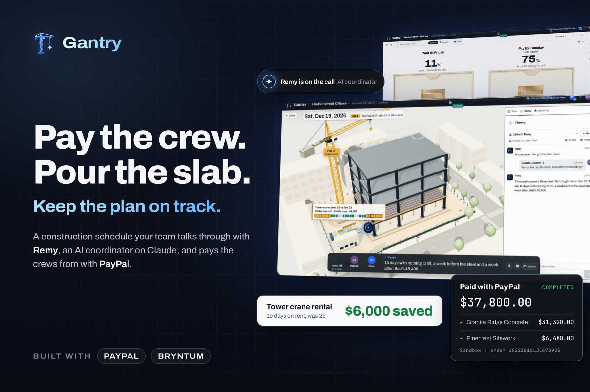

<p align="center">
  
</p>

# Gantry

> **Pay the crew. Pour the slab. Keep the plan on track.**
>
> Late pay stops construction work. Gantry puts the payment in the schedule: when a trade partner's work is done, the general contractor's team pays the firm through PayPal right from the Gantt chart, and the work that was waiting for that money can start. Remy, an AI coordinator on Claude, works the plan with the team in the chat and on their calls. She reads the plan, works out dates and money, drafts changes and invoices, and points things out with her own cursor. Money moves only when a person presses the button.

**[Watch the film (2:59)](https://www.youtube.com/watch?v=dtjWu35chMo)** · **[Try it from Devpost](https://devpost.com/software/gantry-talk-build-pay)** · **[Run it yourself](#run-it-yourself)** · **[How it's built](#how-its-built)**

Built with PayPal and Bryntum for the [PayPal AI Hackathon](https://paypalaihackathon.devpost.com/), Oct and Nov 2026. Rented machines are paid by the day their dates cover, and the tenant gets a PayPal invoice for the changes it asks for. Every payment runs in PayPal's sandbox. Open source under the MIT license.

## Start here

- **Watch the film (2:59):** https://www.youtube.com/watch?v=dtjWu35chMo. One recorded call on the demo project: a crane rental with idle days is cut back, a change order goes to the tenant as a PayPal invoice, and $37,800 goes to two trade partners through PayPal once a second person approves. [How it was made](#how-it-was-made).
- **Try it online:** the live demo is linked from Gantry's [Devpost entry](https://devpost.com/software/gantry-talk-build-pay), under "Try it out". Press "Start a session" (or "Join with a code" if a teammate gave you one): a private copy of the demo project for your visit, with no sign-up, sandbox money only, wiped afterwards. "Try these", on the counter in the header, lists things to do, from calling Remy to paying the footings with PayPal. To be both people in a payment, open Invite, then "Open a teammate in a new tab", and approve from that tab. On this site the crews are paid as one PayPal Payouts batch; the film's PayPal button runs on a local build ([why](#paying-the-crews-two-routes)).
- **The site's date:** it runs on the film's day, Tue, Nov 10, 2026, so the forecast and the odds match the film. Times on messages, calls and payments are real. [More on the date](#the-hosted-sites-date).
- **Run it on your machine:** eight commands and no outside API keys, since Remy and PayPal each have a mock mode. [Run it yourself](#run-it-yourself).
- **Then:** [PayPal and AI together](#paypal-and-ai-together), [how money is protected](#security-permissions-and-payments) and [what's missing](#whats-missing-today).

## At a glance

- **The problem:** late payment stops construction work. In Rabbet's 2025 survey, 82% of contractors said work was delayed or even stopped because money didn't move on time. A payment a few days late can move the handover by more than a week, and a rented machine costs money every day it is on rent, with work for it or not.
- **Who it's for:** a general contractor's project team, the people who plan the job and approve and send its payments. The trade partners and rental firms they pay, and the tenant they bill, deal only with PayPal.
- **What it does:** a shared, live Gantt chart where a payment can hold the work after it. The scheduling engine shows what paying late does to the handover and the odds of making the lease date, and the team pays and bills through PayPal from the plan.
- **AI:** Remy, on Claude Sonnet 5.5 and Opus 5.5, with 45 tools and 14 kinds of card, in the chat and on voice calls with several people (LiveKit, OpenAI transcription, an AI voice). On a local build, Claude also decides where a dropped piece of work belongs in the plan.
- **PayPal (sandbox):** Invoicing v2 bills the tenant. Payouts v1 pays equipment rentals, and progress payments on the hosted site. Orders v2 with PayPal's JS SDK v6 button pays progress payments on a local build, as in the film. Remy reads invoice and payout status from PayPal herself, read only, through PayPal's Agent Toolkit and the Payouts API.
- **Built with:** React, Vite and TypeScript; Bryntum Gantt 7.3.8 and its scheduling engine; Supabase (Postgres, Realtime, Storage, Edge Functions); LiveKit; three.js; Vercel.

## Contents

- [PayPal and AI together](#paypal-and-ai-together)
- [What's new here](#whats-new-here)
- [The film](#the-film)
- [The problem](#the-problem)
- [What it does today](#what-it-does-today)
- [Remy, the assistant](#remy-the-assistant)
- [PayPal](#paypal)
- [Security, permissions and payments](#security-permissions-and-payments)
- [How it's built](#how-its-built)
- [Run it yourself](#run-it-yourself)
- [Tests and quality](#tests-and-quality)
- [What's missing today](#whats-missing-today)
- [What's next](#whats-next)
- [Prior art](#prior-art)
- [Influences](#influences)
- [Credits and attributions](#credits-and-attributions)
- [License](#license)

## PayPal and AI together

Where money moves, and who does what:

| Step | Remy, on Claude | A person | PayPal |
| --- | --- | --- | --- |
| Pay two trade partners for the footings, $37,800 | Works out each firm's amount due from the plan, says what waiting for Friday's pay run does to the handover (on a branch of the scheduling engine), runs the odds, and brings the payment's review up when asked | Reviews it. A second person approves exactly those firms and amounts, and the first sends it | Payouts batch (hosted site) or one order through PayPal's button (local build), each firm paid into its own account. The hold lifts when PayPal reports the payment |
| Bill the tenant for new light fixtures, $125,400 | Drafts the invoice from the plan's costs, a line per floor. The service works out every figure, not the model | Reviews it and presses Send | Invoicing creates and sends it, the tenant pays on PayPal's page, and the card asks PayPal whether it is paid |
| Pay a crane rental for its days on rent | Works out new dates on the machine's calendar and what they cost, and drafts the change | Applies the dates, then presses Send payout | Payouts pays the rental firm, and a PDF receipt is filed when PayPal confirms |
| Find out whether the tenant has paid, or a payout went through | Asks PayPal itself, read only, about this project's own invoices and payouts, and says what PayPal answered | Asks her, in the chat or on a call | Reports the invoice through its Agent Toolkit (its status, what is paid and still due, the due date), and the batch and each payment in it through the Payouts API |

On the hosted site rentals can't be paid yet: each rental firm needs a sandbox account of its own first.

Why it matters: the payment sits in the schedule. A hold keeps the work behind it from starting until PayPal has paid, so the same engine that schedules the job prices a late payment in days, and paying releases the work. Remy reads both sides and answers in the team's words, on their call.

What Remy doesn't do: she can't approve, pay or send. Every payment and invoice starts with a person's press and goes through the app's own functions, and the app keeps its record current by asking PayPal where each payment and invoice stands. What she does with PayPal is read: asked whether the tenant has paid or a payout went through, she checks with PayPal itself, through PayPal's Agent Toolkit for the invoice and the Payouts API for the batch, and only for this project's own invoices and payouts. Code keeps those calls to reading ([Security](#security-permissions-and-payments)). Otherwise her view of a payment or an invoice is the app's record of it, as last checked.

## What's new here

What Gantry does that we did not find on the pages of the products under [Prior art](#prior-art):

- A payment is part of the schedule. Textura holds a payment when lien waivers or compliance documents are missing. Gantry holds the work until the payment is in, so the same scheduling engine that moves the plan shows what paying late does, and paying releases the work.
- The progress payment comes from the plan that people edit: each firm's tasks at their budgets, by percent complete, less retainage, less what was paid.
- The late-payment forecast and the odds run on the same scheduling engine people edit with, in their own browser.
- An assistant drafts plan changes, packages of work and invoices from the live plan, works out what each payment comes to, and joins a call with several people.

## The film

[Watch it on YouTube](https://www.youtube.com/watch?v=dtjWu35chMo).

The film (2:59) is one recorded call on Harbor Street Offices, the demo project. Deepak and Chris, from the general contractor's team, go through three things with Remy:

1. The tower crane is booked for 14 days with nothing to lift. They keep two days either side of the steel and drop the rest, which saves $6,000.
2. The tenant wants new light fixtures. Remy drafts the work and prices it from the quote Deepak gives her, it goes on Level 1, and she offers Levels 2 and 3. They take all three as one change order, and Remy prepares the tenant's PayPal invoice for $125,400, which a person sends.
3. The ground-floor slab is on hold until the footings are paid: $37,800 to two trade partners. Remy says what waiting for Friday's pay run would do (the slab inspection lands in the inspector's week away and the handover moves 12 days) and runs the plan a thousand times. They pay now. Chris approves as the second person, Deepak pays in PayPal's window, and the hold lifts on the chart.

### How it was made


- Deepak's and Chris's lines are scripted and read by AI voices.
- Remy's words are Claude's live replies on the call, spoken in an AI voice from ElevenLabs.
- What Remy's cursor does on screen follows a walkthrough written for the film. Each step waits for what was heard on the call or for what Claude wrote in the thread. The people's clicks are made by the recording script.
- PayPal sandbox: the invoice and the $37,800 payment are real sandbox transactions, with each firm paid into its own sandbox account. The payment used PayPal's own button on a local build.
- The take ran about six minutes. The cut shortens pauses, speeds up waits and moves, plays at 1.11 times speed, and speeds up PayPal's sign-in. The film's footer says so throughout.
- Music: "Airglow" by Stellardrone, under CC BY 4.0.

## The problem

A general contractor runs a project's schedule and its money at the same time, and each one moves the other.

Late payment stops work. In Rabbet's 2025 survey of 125 contractors, 82% said work was delayed or even stopped because money didn't move on time, and 92% of the general contractors had floated payments to subcontractors mid-project in the past 12 months. Rabbet puts the cost of slow payment at 14% of costs, or $299B across US construction in 2025 ([Rabbet, 2025 Construction Payments Report](https://rabbet.com/reports/construction-payments-2025)).

Trade partners carry the gap. In Siteline's May 2026 survey of 492 construction finance and operations professionals, 92% of subcontractors had floated payroll from their own pockets in the past year while waiting to be paid, and 43% waited more than 90 days for final payment and retainage ([Siteline, 2026](https://www.siteline.com/blog/92-percent-of-subcontractors-floated-payroll-last-year-new-siteline-report-finds)).

A late payment can cost more days than it was late. A crew that waits moves all the work after it. If that work then runs into a holiday, a shutdown or an inspector who is away, the handover moves by more than the days the money was late. In the demo plan, paying the footings on Friday's pay run instead of when due pushes the slab inspection into the city inspector's week away, and the engine moves the handover 12 days.

A rented machine costs money every day it is on rent, whether there is work for it or not. When the work moves and the rental doesn't, the days on rent with nothing to do are paid for nothing. In the demo plan the tower crane is booked for 29 days at $600 a day, and 14 of those days ($8,400) have nothing to lift.

Words used here:

- Trade partner: a firm doing part of the work under the general contractor (a subcontractor).
- Scheduled value: what a line of work is worth in the contract. In Gantry, a task's budget.
- Percent complete: how much of that work is done.
- Retainage: a share of each payment held back until the end of the job. Levelset's glossary says it ["typically ranges from 5-10% of each progress payment"](https://www.levelset.com/retainage/).
- Amount due: what the work done is worth, less retainage, less what was paid before.
- Pay application: the bill for work done, on AIA's forms [G702](https://aiacontracts.com/documents/g702-1992) and [G703](https://aiacontracts.com/documents/g703-1992) (the schedule of values).
- Change order: an agreed change to the work and the price.
- Lien waiver: a release of the right to claim a lien on the property, given for a payment ([AIA G901](https://aiacontracts.com/documents/g901-generic-conditional-waiver-release-progress-payment)).

## What it does today

Everything in this section is in this repository's code.

### The plan and the people in it

The schedule is a Gantt chart that everyone on the project edits at the same time, with the money in the same plan: each task has a budget, a forecast, what was spent and what was paid.

Who uses it:

- The general contractor's project team signs in and works in the plan. In the film and on a local build they are Deepak Jayaram and Chris Hale; on the hosted site each visitor takes a name from a list. Everyone in the demo sees costs and can approve payments.
- Trade partners and equipment rental firms are paid through PayPal. They don't sign in.
- The tenant receives PayPal invoices for changes and pays them on PayPal's own page. It doesn't sign in either.

What they see: the chart with its grid, a side panel (Task, Watch, Remy, Crews, Library, Documents, History, Rentals), a 3D view of the building on any date, an odds board, and a call bar when Remy is on a call.

### The demo project: Harbor Street Offices

Harbor Street Offices is a four-story steel-framed office building on a corner lot, from an empty lot to the tenant moving in. The plan has 68 rows: site and foundations, the steel and metal deck under a tower crane, a concrete deck on each level, the roof and the curtain wall, the lobby, three office floors built out one after another, and the handover. It runs from Mon, Oct 19, 2026 to a handover on Thu, May 27, 2027. The lease date is Fri, Jun 11, 2027, set on the handover as a deadline. Twelve trade partners and two rented machines are on the project. Every firm is fictional.

Set up in the plan for people to find:

- The tower crane is on rent from Wed, Nov 25 to Wed, Dec 23, 2026: 29 days at $600 a day, $17,400. The steel it lifts runs Wed, Dec 2 to Wed, Dec 16, so 14 of those days have nothing to lift ($8,400).
- A hold named "Footings paid" keeps the slab on grade from starting until the footings are paid: $37,800 in all, $31,320 to Granite Ridge Concrete and $6,480 to Pinecrest Sitework (their work at 100% complete, less 10% retainage).
- The slab's city inspection runs on the inspector's own calendar, and she is away Mon, Nov 23 to Fri, Nov 27.
- The plan has no light fixtures yet. The tenant, Larkspur Analytics, is billed for the changes it asks for.

The seed (`packages/shared/src/seed/harbor.ts`) is the source of all of this. Harbor is the one project the app lists. The seed also writes two projects reached only by a link, Cedar Park Clinic and Riverside Clinic (the automated tests' fixture), and twelve unlisted copies of Harbor for the hosted site (below).

### Planning together, live

- Every edit is one Bryntum transaction: a drag on the chart, a cell edit, a library drop, or a change Remy drafted that someone applied. The browser sends it to the `submit_revision` function in Postgres, which checks the person is a member, numbers the change and stores it. A database trigger broadcasts it on the project's private Realtime channel, and every open browser applies the numbered changes in order, the sender's own included.
- A badge in the header says Synced, N pending, Sync error (with Retry) or Out of sync (with Reload). Edits made offline wait in an outbox and go out on reconnect. A browser that missed a change fetches it, and every open browser re-reads the log every 30 seconds.
- The header shows who else is in the plan. Their pointer moves over your plan with their name, on the same task and date even when your window, zoom or scroll differ, because a position travels as a task and a date, never as pixels. Their selected cells are tinted in their color, and a cell they are editing, a fill they are dragging or a bar they are moving shows while it happens.
- Click an avatar to follow that person. Your plan shows the same dates at the same zoom, with the same row in the middle, their selection, and how they have the plan folded, sorted, filtered and grouped. Escape, a scroll or a click of your own gives you the controls back, and "Back to my view" restores yours.
- Pointers and views travel on a separate channel, at most 20 messages a second each, and are never stored.

Code: `apps/web/src/sync/`, `apps/web/src/presence/`, `supabase/migrations/20261021210009_revisions.sql`.

### The chart and the task panel

- Bars show their state by shape and fill as well as color: not started is an outline, work in progress is solid, done steps back, days past the planned finish are hatched red, inspections have angled ends, rented machines are capsules ([bar language](docs/design/bar-language.md)).
- The grid has 33 columns to pick from, and each person keeps their own layout. Editing: drag and resize bars, edit cells, a context menu (add, indent, split, copy and paste whole branches), the fill handle, and Delete.
- The Task tab holds the fields of Bryntum's own task editor: Details, Scheduling (all constraint types, calendars, scheduling mode), Links (all four types, with lag), Crew, Equipment, Costs, Files and Notes.
- Undo and Redo (Cmd+Z or Ctrl+Z) take back your own changes as new revisions for everyone, while other people's changes stay. The History tab lists everything that happened to the plan, built from the server so everyone sees the same list.
- The View menu groups and colors the bars and opens a crew workload chart and a crew schedule (Bryntum Scheduler Pro on the same project). Dragging a bar to another crew's row hands the task over.

### The library: pieces of work to reuse

- Select tasks, right-click, "Save to library…", and the work is saved with its links, crews, working days and notes, without dates, progress or money. Pieces are filed in folders and edited in a builder that is a small Gantt chart of its own, where a piece also gets time ranges (bands such as curing time) and what each task costs and who is paid.
- Drag a piece onto the plan. A card asks how to tie it in, with what each choice would move worked out on a copy of the plan: push the later work back, fit it in without moving anything, start it alongside a task, or leave it unlinked.
- Where it goes in a group is asked of Claude (the `place-snippet` function), which reasons about the trades and their order, for example that light fixtures go in with the ceiling tiles. When Claude can't be asked, the browser places it by its own rules, as it always does on the hosted site, where a drop never calls a model.
- A drop is one change for everyone, with Undo. Remy is told where it landed and offers the same piece in similar places, such as the other floors.

Code: `apps/web/src/library/`, `apps/web/src/inspector/LibraryPanel.tsx`, `supabase/functions/place-snippet/`. Scenarios: [docs/library-scenarios.md](docs/library-scenarios.md).

### Rentals: the dates are the deal

- A rented machine is paid for every calendar day on rent, weekends included, and whatever its dates say is what gets paid.
- A machine has its own dates on each task. They show in the Equipment cell and as an outline on the bar. Changing them is a plan edit like any other: numbered, sent to everyone, undone and redone with the rest of the plan. Remy can work out new dates too ("two days either side of the work").
- Days on rent outside the work are idle. Up to two working days either side count as cover, the way a machine is usually booked, and aren't flagged. A weekend inside the work is paid but isn't idle, since no dates can take it away.
- The Rentals tab lists every rental, what its dates come to, and whether it is paid. Review payment, then Send payout, pays the firm through PayPal Payouts. The dates lock while PayPal pays, and a PDF receipt is filed on the task when PayPal confirms.

Code: `packages/shared/src/rental-days.ts`, `apps/web/src/editor/`, `apps/web/src/workflow/rental.ts`.

### Holding work until it is paid

- Right-click a task and choose "Hold what follows until this is paid". A milestone goes in after it with a finish-to-start link into the next work, so the scheduling engine won't start that work before the payment is in. If the payment is late, the held work and everything after it move, through weekends and holidays.
- The chart draws the hold: the link is amber with a stop mark until PayPal has paid. Then the mark goes, the link runs PayPal blue for a moment, and the hatching on the held work fades.
- The hold's card can also set the day it will be paid. That is an ordinary plan edit, so the held work moves for everyone.
- Under AIA's standard general conditions (A201-2017, section 9.7), a contractor may stop work once the owner is seven days late paying, and only after seven more days' notice ([AIA](https://learn.aiacontracts.com/articles/6446040-can-a-contractor-stop-work-if-it-hasnt-been-paid/)). Gantry's hold is a pay-to-proceed term a project chooses, not that rule.

### Progress payments with retainage, and a second approval

- A hold's card in the Task tab shows the progress payment the way a pay application works it out: each trade partner's tasks at their scheduled value (the budget), times percent complete, less retainage (10% by default), less what was paid before. The result is the amount due for each firm.
- "Review payment" opens a payment window with each trade partner, its scope, percent complete, scheduled value, retainage and amount due, PayPal's fee, and what paying releases on the plan.
- A payment over the project's threshold ($25,000 unless the project sets another) needs a second person who sees costs to approve exactly those firms and amounts. The request appears on their screen live, and the database checks the approval again right before PayPal is asked ([Security](#security-permissions-and-payments)).
- Then the payment goes to PayPal (see [PayPal](#paypal)). When PayPal reports it paid, each task's share is recorded as paid and the held work is released.

Code: `packages/shared/src/progress-payments.ts`, `apps/web/src/gantt/pay-gates.ts`, `apps/web/src/payments/`, `supabase/migrations/20261108010000_pay_gate_approvals.sql`.

### What paying late does

Bryntum's scheduling engine keeps the plan as a graph that can be branched: a branch starts as a copy of the live plan and changes on its own while the live plan never sees it. For a day the money could land, Gantry branches the engine, sets the hold to that day, reads where the held work and the handover land, and throws the branch away. Weekends, the holiday shutdown, public holidays and the inspector's own calendar all come from the engine, which is how a payment a few days late can move the handover by more than a week.

Ask Remy what waiting for the Friday pay run would do, and her `late_payment_effect` tool runs this in your browser: she says when the held work would start, what it would wait out on its own calendar and where the handover lands, while dashed outlines on the chart show where each task would go. Nothing in the plan changes. The payment window uses the same forecast to show when paying now releases the work.

Code: `apps/web/src/gantt/late-payment.ts`, `apps/web/src/gantt/late-payment-effect.ts`.

### The odds board

- The On-time odds button (or Remy's `schedule_odds`) runs the plan 1,000 times. Each run is a branch of the engine: every task with work left gets a length drawn from a three-point range, each hold is paid by the chosen rule, and the handover is read back.
- The default ranges, as multiples of the planned length, are 0.9 to 1.35 for outdoor work in winter, 0.95 to 1.2 for other outdoor work, 0.95 to 1.15 for indoor work, and 1 to 1.5 for inspections. Runs use a fixed seed (7), so the same question about the same plan on the same day gives the same answer. Every assumption is on screen and can be changed.
- The results: the chance of handing over by the lease date, the spread of handover days, and the tasks that move the handover most. A "ways forward" list tries actions on the engine: pay a hold when due instead of on the Friday pay run, or work Saturdays on part of the plan at 1.5 times pay ($65 an hour by default), each step with its gain and its cost.
- The runs are drawn as a marble board. Each marble is one run and lands in the bin of that run's handover day. The engine decides every bin; physics (Rapier, in a web worker) only finds a real fall through the pegs that ends there. Two boards can stand side by side to compare paying Friday with paying now, and two plain lines under them say what was run and the step to take.

Code: `apps/web/src/gantt/monte-carlo*.ts`, `apps/web/src/odds/`.

### Invoices to the tenant

- A change order: Remy drafts the invoice from the plan (`draft_change_invoice`), with a line for what is bought once and a line per floor listing its tasks. A person who sees costs reviews it and presses Send, and the `paypal-invoice` function creates and sends it through PayPal Invoicing. The tenant pays on PayPal's own invoice page.
- Finished work: a watch rule can prepare an invoice when, say, the fixtures on a floor are finished. A person sends it the same way.
- An invoice over $60,000 lets the payer pay it in parts.

Code: `supabase/functions/_shared/invoices.ts`, `apps/agent/src/agent/invoice-tools.ts`, `apps/web/src/assistant/change-invoice-card.tsx`.

### Documents and receipts

- Each project has a document store: quotes, invoices, receipts, photos, drawings and reports, filed against tasks, with a Files tab on each task and a Documents tab for the project. Files live in private Supabase Storage.
- Quotes, invoices and receipts are cost-sensitive: row-level security hides them, and their files, from members who can't see costs.
- When PayPal confirms a rental payment, a one-page PDF receipt (amount, PayPal's fee and references, the rental days, who approved what and when) is filed on the task, once, whichever of the functions sees it first.
- The text of each document is kept for Remy, who can quote the supplier's quote by name.

Code: `apps/web/src/documents/api.ts`, `supabase/functions/_shared/receipt.ts`.

### Watch rules in plain English

- Tell Remy what to watch for, for example "Tell me when rented equipment is sitting idle or booked twice, and suggest a fix". She turns it into a rule shown as blocks, with what it would find right now. Nothing is watched until someone presses Start watching.
- A rule reads as a sentence: when (every change, or once a day at a set time), if (late, little slack, over budget, money spent ahead of the work, idle rentals, double bookings, work finished, and more), then (show it, ask Remy to look into it, or prepare an invoice).
- Rules are plain code with no model involved, checked by the assistant service once per change. They only raise findings and never change the plan.

Code: `packages/shared/src/watch.ts`, `apps/agent/src/agent/watch.ts`, `apps/web/src/alerts/`.

### The 3D site view

- On Harbor the toolbar's Site view button turns the chart's side into the building, standing on its lot on the date on show. The bars lift off the chart and fly into place, and the building goes up as they land. Right-click a bar and choose "Show in the site view" to drop through that bar into its piece.
- One row is one piece of the building, and pointing at either lights the other. The building can be taken apart story by story, and the date can be scrubbed. The crane's rental is drawn day by day on a calendar on the lot: idle days, cover, work and paid days off.
- It is meant for deciding whether to pay: what the money covers and what the plan has by a date. The task panel and Remy work there too.
- On plans that aren't a building, the same button opens a site board: the work laid out along a road in the order it is built. `?fx=off` in the address leaves the 3D view out, and without WebGL the chart stays as it is.

Code: `apps/web/src/gantt/fx3d/` (three.js).

### First steps, coaching and how-to clips

- On a listed project, a row of steps in the header follows the work, and each step checks itself off from the project's own data. After a pause, a coach points at the next thing to do.
- Asked how to do something in the app, Remy plays a short screen recording of the real app in the thread, with its steps under it. Five clips ship today: link two tasks, save work to the library, add work from the library, watch the plan with a rule, and invite someone into a conversation. Playwright records them (`pnpm clips`).

### Simulated teammates

`pnpm crowd:harbor` signs two simulated people into Harbor in a headless browser. They work in their own parts of the plan like anyone else, with real edits, and with an Anthropic key Claude writes their notes and intents from the plan's task names. Their names end in "(sim)", they can't see costs, and stopping the script puts back everything they moved. `?team` in the address shows look-only teammates in your own page instead, with nothing written.

### Walkthroughs

`?rails=film` on Harbor plays the film's story as a walkthrough of twelve steps, one press of Next each, through the real interface. Remy's cursor acts the way a person's would, and Previous puts the project back as it was before the step. `?rails=floors` plays the light-fixtures part alone.

### A private session on Harbor for each visitor (the hosted build)

A hosted build (`VITE_GANTRY_HOSTED=1`, see [How it's built](#the-hosted-build-and-its-deploy)) has no sign-in screen and no demo accounts. A visitor presses "Start a session", passes Cloudflare Turnstile's check, is signed in anonymously and gets one of twelve copies of Harbor for the visit.

- The database keeps the pool of copies. A copy is held for 30 minutes at a time, renewed every 2 minutes while the visitor's tab is in view, and kept at most 2 hours from the claim. A sweep every 10 minutes resets any copy whose time ran out and frees it. When every copy is in use, the visitor sees "Every session is in use" and the film.
- Each person takes a name from a list of 30, offered before they join. Nobody types a name, and nobody can rename themselves through the API. The first person is the construction manager and the others project managers, five people in all.
- "Invite" shows the session's 6-digit code and its invite link. A code joins only a session that is open. After 8 wrong codes in 10 minutes a person must wait, and so must a network after 20 in an hour. A person can join 3 sessions an hour, and a network 10. "Open a teammate in a new tab" signs that tab in as a second person, so one person at one computer can try two seats: live cursors, Follow and the second approval on a payment.
- "Start over" resets the session for everyone in it and signs this tab out, so a fresh session takes a new anonymous sign-in and a new Turnstile check: each sign-in gets one session, ever. One network can start a session every 2 minutes, 5 an hour and 15 a day, and hold 2 at once.
- The chart opens where the film does: on the footings' payment hold, with the slab it holds hatched and tagged "held until paid", the plan's today and the week the city inspector is away. A local build opens at the plan's start, and the walkthroughs set the chart themselves. Each visit's library starts with the film's light fixtures package, and whatever a visitor saves there goes when the session is reset.
- "Try these", on the counter in the header, has eight things to do, in any order, and ticks each off when it happens: call Remy, invite a teammate, drag a library package onto Level 1, open the 3D view, ask Remy about paying on Friday, check the on-time odds, send the tenant's invoice, and pay the footings with PayPal (a second person approves it from a teammate tab). The crane's rental stays off the list until the rental suppliers have sandbox accounts of their own.
- Three switches in the database (live AI, calls, payments) decide whether the call is offered and which items the list shows. Each session also has its own allowance of Remy's turns, her minutes on calls, call joins and PayPal payments ([limits](#security-permissions-and-payments)). The walkthroughs are not in a hosted build.

Code: `apps/web/src/copy/`, `apps/web/src/onboarding/try-these.ts`, `apps/web/src/gantt/opening-view.ts`, `supabase/migrations/20261110120100_flags_and_quotas.sql`, `supabase/migrations/20261110120200_copy_pool.sql`, `supabase/migrations/20261111010000_session_codes_and_names.sql`, `supabase/migrations/20261111040000_visitor_limits.sql`, `supabase/migrations/20261111120000_copy_library.sql`.

### The hosted site's date

The hosted site runs the plan on the film's day, Tue, Nov 10, 2026. Harbor's dates are fixed, and the film was recorded that day: the footings payment falls due on Nov 10, and waiting for Friday's pay run (Fri, Nov 13) pushes the slab's city inspection into the inspector's week away, so the handover moves 12 days, from Thu, May 27 to Tue, Jun 8. On the real clock, a visit in December would find that payment weeks overdue, and the forecast and the odds would no longer match the film.

- **Pinned:** the plan's today. The odds, the Friday pay run in the late-payment forecast, the chart's today line, the 3D view, the watch rules and what's due now in a task's costs all count from Nov 10. The time of day is real, so the today line still moves through the day. The header says "Plan date: Tue, Nov 10, 2026", and pressing it says why. Remy's service pins the same day (`GANTRY_PLAN_DATE` in [apps/agent/fly.toml](apps/agent/fly.toml)): her watch rules count from it, and she's told the plan's date.
- **Real:** the times on messages, calls and captions, who's online, the session's time limit, payment times, the change history, analytics and sign-in. PayPal's sandbox records (payouts, orders and invoices) carry the real date of your visit.
- **On your machine:** the plan follows the real clock. To pin it, set `VITE_PLAN_DATE=2026-11-10` for the web app and `GANTRY_PLAN_DATE=2026-11-10` for the assistant service in `.env.local`, then restart both. `VITE_PLAN_DATE` also overrides the hosted build's day.

Code: `apps/web/src/plan-clock.ts`, `apps/web/src/app/PlanDate.tsx`, `apps/agent/src/plan/today.ts`.

## Remy, the assistant

Remy is the assistant's name everywhere in the app: the side panel tab, her replies, her cursor and her seat on a call. Behind her is Claude, through the assistant service in `apps/agent`.

### Where you talk to her

- The Remy tab holds conversations. General is everyone's. Each new question starts a private conversation that its starter can invite people into or share with the project. Inviting someone who can't see costs into a conversation where someone can asks you to confirm first that the costs in it are shared, and the server records who confirmed.
- Select tasks before asking and the question is about them. Task names in her replies are buttons that show the task in the plan.
- She answers with cards as well as words: a problem with the money at stake, task lists, charts drawn from the live plan (crew workload, progress, cost by floor or by firm, cash flow), schedule check findings, a plan change to apply, draft library pieces, rule drafts, invoices, choices to tap, and how-to clips.

### What she can do

She has 45 tools and 14 kinds of card. The tools:

- Read the plan: `find_tasks`, `get_task`, `get_plan_overview`, `get_critical_path`, `get_crew_workload`, `check_schedule`, `get_milestones`, `get_calendars`, `get_time_ranges`, `get_plan_changes`, `find_issues`.
- Work out numbers exactly: `calculate` (decimal arithmetic), `sum_costs`, `count_working_days`. Numbers come from tools, never from the model's head.
- Rentals and payments: `get_booking`, `rental_options` (dates on the machine's own calendar, priced by the day), `get_payment_status`, `get_progress_payments`, and `check_with_paypal`: PayPal's own answer, read only, for this project's invoices (status, amount, what is paid and still due, the due date, when it was paid) through PayPal's Agent Toolkit, and for its payouts (the batch's status and each payment's) through the Payouts API. A crew payment made with PayPal's button on a local build is read from the Orders API.
- Ask the scheduling engine, in the asker's browser: `late_payment_effect` and `schedule_odds`.
- Show things on the asker's screen, with her own cursor gliding to each control before it acts: `site_view` (the 3D view, or a ride up the crane), `play_site` (the building going up from one day to another: the plan as drawn, never the odds), `go_to_task` (by name, outline number or row, or a cell), `filter_plan`, `search_plan`, `expand_plan`, `zoom_plan`, `open_panel`, `open_review` (a payment's review or the tenant's invoice, where a person presses Send), `close_view` (the window, sheet or panel that is open), `open_library_piece`, `drag_library_piece` (a package carried onto a row of the chart, where the person picks how to tie it in) and `undo_redo`. Each request is checked against a fixed list of actions before the browser runs it. With each message she also gets a short note of the sender's screen (on a call, the speaker's): the chart or the 3D view and its day, the side panel, a window over the page, the open library card, the search, the filter and the dates in view, checked field by field in the database, so "close that" means what they see.
- Look anything up: `query_plan`, a read-only query over the plan's tasks, links, crews, assignments, calendars, time ranges, rentals and payment holds. Fields and operators come from fixed lists, so nothing the model writes runs as code.
- Draft: `draft_plan_edit` (16 kinds of operation: add, change, move, indent, outdent, copy or delete tasks; link, unlink or change links; add a firm, give or take a crew; set rental dates; set a cost and who is paid; drop a library piece), `draft_snippet`, `find_repeating_work`, `find_similar_places`, `list_library`, `draft_change_invoice`.
- Other: `read_documents`, `get_watch_list`, `reply` (her words, streamed as she writes them), `stay_quiet`.

### How her changes go in

- A drafted plan change shows as a card with every operation and a preview of what moves, the handover date included, worked out in the browser on a copy of the plan.
- A switch under the message box sets how it applies: Always ask (the default: nothing changes until someone presses Apply), Ask if risky (small checked changes go in by themselves; deletions, unlinking, a change to who is paid, a moved handover, more than 10 steps or more than 10 tasks moving wait for Apply), or Auto-apply.
- Every money amount and date on a card has to come from a tool result. If it doesn't, the card is refused and she has to fix it in the same turn.
- She can't approve, pay or send: there is no tool for it, and the database and the PayPal functions need a signed-in person. Sending an invoice, approving and paying are always a person's presses ([Security](#security-permissions-and-payments)).

### On a call

With the dev server, LiveKit and Remy's call worker running (see [Call Remy](#call-remy)), `?call` in the address puts a "Call Remy" button in the header. A hosted build offers the call without `?call` when its switch is on.

- Everyone on the call is heard on their own audio track, so every line has a speaker. Remy's call worker transcribes each person with OpenAI's realtime transcription and shows live captions for everyone.
- With others on the call, Remy answers only when someone addresses her by name ("Remy, …", "…, Remy?"), or when the same person follows up within 8 seconds of her answer. People talking to each other get no answer. Alone with her, you just talk: every line is for her, except a plain "okay" or "thanks" after her answer.
- What you say to her goes into the conversation as your message, in your words as heard, posted by your own tab. Claude answers in the thread as always, and the tab of the first person on the call hands each answer to her voice. Her voice is OpenAI's text-to-speech by default. If both `ELEVEN_LABS_API_KEY` and `ELEVEN_LABS_VOICE_REMY_KEY` are set, she speaks with that ElevenLabs voice instead; that is optional.
- If her answer is slow, she says a short filler ("Let me look.", "Pulling it up."), and one more short line ("Still on it.") if the answer still hasn't come four and a half seconds after that. Talking over her stops her, while a hummed "mm-hm" doesn't. Her face on the call bar breathes with her voice and shows when she is thinking.
- On the hosted site a session has five minutes with Remy on calls in all, shared by everyone on it. The header shows what's left as an orb beside the call button, and the call bar shows it running down during a call, the same for everyone on it.

Code: `apps/remy-call/`, `apps/web/src/call/`, `apps/web/call-dev.ts`, `apps/web/call-hosted.ts`.

### Models

- Replies: Claude Sonnet 5.5, at low effort when typed and medium effort when spoken. Weighing an issue, working out alternatives for a watch rule, and finding where else a dropped piece belongs: Claude Opus 5.5 at medium effort. Both can be changed with environment variables; the hosted site uses Sonnet 5.5 for both (`apps/agent/fly.toml`).
- Placing a library piece: Claude Opus 5.5 at low effort (`place-snippet`).
- Each turn is one streaming tool loop of at most 10 model calls, with prompt caching. Her first words come through the `reply` tool, so they stream while she is still drafting cards.
- `AGENT_MODE=mock` runs a scripted stand-in with no key and no cost.

## PayPal

Everything here runs on PayPal's sandbox. No real money has moved.

| What | PayPal | Where in the code |
| --- | --- | --- |
| Billing the tenant for a change order or finished work | Invoicing v2 | `supabase/functions/paypal-invoice` |
| Paying an equipment rental | Payouts v1, one payment | `supabase/functions/paypal-execute-payout`, `paypal-reconcile` |
| Paying trade partners their progress payment, on the hosted site | Payouts v1, one batch with a payment per firm | `supabase/functions/paypal-progress-payout` |
| Paying trade partners their progress payment, on a local build (the film) | Orders v2, approved with PayPal's own button (JS SDK v6), one purchase unit per firm | `apps/web/paypal-dev.ts`, `apps/web/src/payments/PayPalButton.tsx` |
| Remy checking whether the tenant has paid, or a payout went through | PayPal Agent Toolkit (`get_invoice` only); Payouts v1 and Orders v2, one GET each. Read only | `apps/agent/src/paypal`, `apps/agent/src/agent/paypal-tool.ts` |

With `PAYPAL_MODE=mock`, every call gets a fixed, PayPal-shaped answer and nothing leaves the machine. The crew payment then shows Send payout and a mocked Payouts batch instead of PayPal's button, and Remy says PayPal isn't connected and answers from the app's records.

### Paying the crews: two routes

- **On a local build with `PAYPAL_MODE=live`, as in the film.** Once a second person has approved the amount, the contractor presses PayPal's real button, signs in on PayPal's window and approves once. One order carries a line per firm, and PayPal settles a separate payment into each firm's own account. A full-size payment, $31,320 and $6,480 to two different accounts, completed this way in the sandbox.
- **On the hosted site.** It has no PayPal sign-in to offer its visitors, so Send payout pays the same firms as one Payouts batch from the sandbox contractor's PayPal balance, through `paypal-progress-payout`. The batch id is the payment's own, so a press after a lost answer gets the same batch back instead of a second payment. The footings payment, $31,320 and $6,480 to the two firms' own accounts, was paid this way in the sandbox.

Both routes claim the payout in the database with the sender's own login before PayPal is asked, so the two-person rule holds on both. In the sandbox each firm is paid into its own test account (`PAYPAL_SANDBOX_<first word of its name>_EMAIL`). A live payment is refused if a firm has no account, if two firms share one, or if its account is set up for anyone else too, such as the tenant, since the screen says who was paid.

### Why the film pays with PayPal's button

Payouts would cost far less: $0.25 a payment, against 3.49% + $0.49 taken from what each firm receives through PayPal's checkout. On the $37,800 footings payment that is $0.50 instead of $1,320.20. But Payouts runs server to server, so in real use each contractor would have to trust this app with their PayPal API key, and it can spend only the PayPal balance. With PayPal's button the contractor approves at PayPal and doesn't have to give us a key. The hosted site uses Payouts with the sandbox contractor's key because it has no PayPal sign-in to offer its visitors.

### Rentals and invoices

- A rental payment goes out as one Payouts item. Our operation id is the `sender_batch_id` and the `PayPal-Request-Id`, so a retry is the same request and PayPal never pays it twice. `paypal-reconcile` asks PayPal where it stands and moves it to paid or failed, and the receipt is filed. Status always comes from asking: the page asks every 2.5 seconds while a progress payout settles and every 20 seconds for a sent invoice while its card is on screen, and a rental is checked when someone refreshes it. A signature-checked `paypal-webhook` handler for payout events is written and tested, but no webhook is registered with PayPal.
- A rental is paid to the address it was approved for. It is refused if that address is another party's sandbox account, so a supplier needs a test account of its own (`PAYPAL_SANDBOX_<first word of its name>_EMAIL`, which `scripts/gen-seed-local.ts` writes into the rentals). An address with no PayPal account behind it is held by PayPal as unclaimed, and the screen says so.
- An invoice's row id is its `PayPal-Request-Id`, so a retry after a lost answer gets the same draft back. The invoice comes from the business named in `PAYPAL_INVOICER_NAME`.
- On the hosted site every invoice bills the tenant's sandbox account (`PAYPAL_SANDBOX_TENANT_EMAIL`), whatever the project says, and the review window names that address before anything is sent.
- The functions refuse any `PAYPAL_ENV` other than `sandbox`. On the hosted site they also check a payments switch and each session's caps before PayPal is asked ([Security](#security-permissions-and-payments)).

### What going live would take

None of this has been tried with real money. It comes from PayPal's documentation:

- Paying several firms in one order sits under PayPal's platform program:
  ["go live after your platform or marketplace has been approved"](https://developer.paypal.com/platforms/overview).
  Gantry hasn't applied, and [each firm would have to onboard](https://developer.paypal.com/docs/multiparty/get-started/).
- Payouts is gated too: [you have to request access](https://developer.paypal.com/docs/payouts/standard/), and PayPal decides.
- Invoices go out with the app's own PayPal API key, which belongs to the sandbox contractor's account. Sending them for
  many contractors needs PayPal's partner onboarding, which is open to approved partners only. Our sandbox app was refused.
- Paying the crews with PayPal's own button runs in the Vite dev server (`apps/web/paypal-dev.ts`); only the Payouts
  batch has a deployed function (`paypal-progress-payout`) so far.
- The payment safeguards a real business would need are listed under [For real use](#for-real-use-how-we-would-layer-it).

## Security, permissions and payments

Anyone on a call can ask Remy for anything, so this is what stands between a request and the money: what the code does today, what the hosted demo relaxes, and what real money would need.

### What protects money today

- **Remy can't approve, pay or send.** None of her 45 tools or 14 cards does any of it (`apps/agent/src/agent/tools.ts`). What her cursor may do in a person's browser is a fixed list, checked before the browser runs anything (`UiAction` in `packages/shared/src/agent.ts`), and its only money actions open a payment's review or the tenant's invoice.
- **Remy's PayPal access is read only, and code keeps it that way.** The assistant service holds the sandbox REST app's key, the one the functions pay and bill with, so `check_with_paypal` can read status. PayPal doesn't make that key read only: it can do whatever the app can, paying included. So every request the service sends to PayPal passes an allowlist first (`apps/agent/src/paypal/read-only.ts`): signing in, and a GET of one invoice, payout batch or order by its id, on the sandbox. Anything else is refused before it leaves the service. The Agent Toolkit is set to list only `get_invoice`, but its handler runs any of its tools when asked, so the check sits on the toolkit's own HTTP client, not in its settings. A test sends every other toolkit tool through it, sends and payments included, and none gets out. The ids come from this project's own records, never from the model, and nothing lists or searches the PayPal account, which holds every session's invoices.
- **Every payment is a person's press, under their own login.** The functions that pay and bill accept only a signed-in person's session, checked with Supabase Auth, from a member of the project who sees costs. A payout must also be within that person's approval limit (`supabase/functions/_shared/handlers.ts`, `progress-payouts.ts`, `invoices.ts`).
- **Two people over a threshold.** A progress payment over the project's threshold ($25,000 unless the project sets another) needs a second member who sees costs, with a limit that covers it, to approve exactly those firms and amounts on their own screen. Right before PayPal is called, the database claims that approval with the sender's own token. It refuses if the approval is missing, declined, more than 30 minutes old, already used, given by the sender, or for other firms or amounts, and the person who asked is the one who sends (`claim_pay_gate_payout`, `supabase/migrations/20261108010000_pay_gate_approvals.sql`).
- **Payees are set on the server.** A progress payment pays each firm into the sandbox account the server has for that firm, never an address the page sends, and is refused if a firm has none, if two firms share one, or if the account is set up for another party too (`supabase/functions/_shared/accounts.ts`). A rental is paid to the address its booking was approved with: browsers can't change a booking's payee, a change to the address cancels the approval, and the address can't be another party's account. On the hosted site every invoice bills the tenant's sandbox account.
- **The work holds still while money moves.** While PayPal pays a rental, the database refuses any change to the task the money is for, and any delete of the group holding it (`supabase/migrations/20261025040000_payment_lock.sql`). Work behind a payment hold can't start until PayPal reports the payment.
- **Nothing is paid twice.** Each PayPal request that pays or bills carries our own id as its `PayPal-Request-Id` (and `sender_batch_id` for payouts), so a retry after a lost answer is the same request.
- **Caps on the hosted site.** One switch turns every payout and invoice off. Each session may send three payouts worth $60,000 in all and three invoices, and the whole site 30 payouts worth $150,000 and 60 invoices a day. A payment refused there never reaches PayPal (`use_payment_quota` in `supabase/migrations/20261111020000_payment_quotas.sql`; each limit is a row of `quota_limits`, set in `supabase/migrations/20261111040000_visitor_limits.sql`).
- **The database checks who is asking.** Writes to the plan and to payments go through SQL functions that check membership, and Realtime channels are private to the project's members.
- **A call can open a payment, never send it.** A line said to Remy goes into the thread as the speaker's own message, posted by their own tab under their login, and her screen actions run in that tab: asked to pay, the most she can do is bring the payment's review up there, in front of a person.

### Who sees costs

- Each membership has a role, a "can see costs" flag and an approval limit. Row-level security in Postgres keeps quotes, invoices, receipts and payment approvals from members who can't see costs, and the approval functions check each person's limit. The app hides the money columns, the Costs tab and the Rentals tab from them.
- Remy follows the same rule. In a conversation read by someone who can't see costs, she leaves amounts out of her words and cards, unless someone who can see costs chose to share them in that conversation.
- In the demo, locally and on the hosted site, everyone sees costs and can approve up to $250,000. The simulated teammates can't see costs.

### How many people

- **A session** on the hosted site is one private copy of the demo project with at most five seats: whoever started it and up to four people who join with its 6-digit code or invite link, a teammate tab included. Names come from a fixed list, and nobody types one.
- **A call** is one room per project, and on the hosted site one room per visit. A hosted room holds at most four, Remy included, so three of the session's five people can be on a call at once (`apps/web/call-hosted.ts`). A session has five minutes with Remy on calls in all, kept by the site (`supabase/migrations/20261111150000_remy_minutes.sql`): whoever starts a call and whoever joins it later draw on the same minutes, each call gets what the earlier ones left, and a call counts until the site sees her off it. A call ends for everyone when they run out, or after 30 seconds nobody speaks. A tab left in the background for 10 seconds, or sent there a third time on one call, leaves the call, unless another of the session's tabs is in front in the same browser (a teammate tab opened from Invite, say). Nobody stays connected longer than six minutes. If everyone hangs up she leaves after 10 seconds. Once the minutes are used up, the call button is gone for the rest of the visit, and she isn't brought into a call with fewer than six of her turns left. A session's people can join calls 40 times in all, and the whole site's 300 times a day. The whole site takes 30 calls with her a day (calling her back within ten minutes doesn't count again), and by default she is on at most five calls across the site at once. She runs at most 40 turns per session and 500 a day across the site. A daily spending cap adds up what Anthropic, OpenAI, ElevenLabs and LiveKit cost, and switches Remy or her calls off once one vendor's share, or $28.50 in all, is spent, until 00:05 UTC (`supabase/migrations/20261111060000_spend_breaker.sql`, with today's numbers in `20261111170000_calls_for_judging.sql` and `20261111180000_calls_hardening.sql`). When a call can't be had, the call button is greyed and says why before anyone presses it ("Calls paused until 4:00 PM"). A local build sets none of these limits.
- **One assistant, one turn at a time.** Each project has one agent in the assistant service, and it takes one turn at a time, from the chat or the call, while the rest wait (`apps/agent/src/project-agent.ts`). With more than one person on a call she answers only when someone names her, or when the same person follows up within 8 seconds of her answer (`apps/remy-call/src/addressing.ts`). Alone with her, every line is for her.

### What that means for payments

- On the hosted demo every seat sees costs and can approve up to $250,000. Anyone in a session can ask for a progress payment, approve someone else's, and send their own once it is approved. That lets one visitor play both people with a teammate tab, and it also means a second approval there proves two signed-in seats, not two different people.
- A voice proves nothing about who is speaking. A line is credited to the account whose microphone carried it, and on one computer two tabs' microphones hear the same voice. Gantry never takes a voice as an approval, and nothing said on a call approves, pays or sends.
- A change Remy drafts can change a task's cost or its percent complete, and both feed the amount due. With Always ask, the default, nothing changes until someone presses Apply. Ask if risky lets small changes go in by themselves, a cost included, but holds a change to who is paid; Auto-apply lets every change in. Either way the amounts are on the review before anyone presses Send.

### Gaps we know about

- Each firm's amount due is worked out in the sender's browser from the plan. The database checks that a payment matches what the second person approved, but doesn't recompute it from the plan, and the plan behind a progress payment isn't locked while PayPal pays it.
- The plan's money fields (budgets, forecasts, what was paid) travel in the revision log, which every member can read; only the app hides them.
- The assistant service uses the database's service-role key, which row-level security doesn't bind, and so do the hosted site's call routes, to check membership and keep the limits and Remy's minutes. The assistant service also holds the sandbox PayPal key the functions pay with, and only its own code keeps that key to reading. The PayPal functions accept only a person's session.
- A progress payment's PayPal batch or order id is kept on the plan, which members edit, so a member who knew another session's id could point Remy's check at that payout and read its status and amounts. An invoice's PayPal id is written only by the functions. A session's ids reach only its own members, and on the hosted site the copies are wiped after each visit.

### For real use: how we would layer it

These are plans, not features.

- **Roles in tiers:** each member already has an approval limit; real use needs named roles with set limits, such as a project manager up to one amount and a project executive above it, set by an administrator.
- **Separation of duties:** whoever asks for a payment isn't whoever approves it, and whoever approves it isn't whoever releases it. Today the person who asks also sends, and someone else approves.
- **Step-up at the moment of paying:** a passkey (WebAuthn) check on Send and Approve, and PayPal's own consent where the route has it. With PayPal's button the payer already signs in and approves at PayPal; the Payouts route has no such step.
- **Voice and the assistant prepare, never authorize,** as a rule no project setting can switch off.
- **Spoken requests confirmed on screen:** a request said on a call already lands in the thread as the speaker's message, in their words as heard. For money, the speaker would also confirm it on their own screen before the review opens, and the thread would keep that confirmation.
- **Amounts only for people who see costs, everywhere,** the plan's money fields in the revision log included.
- **Amounts worked out on the server** from the plan at the approved revision, with that part of the plan locked while PayPal pays.
- **Payee changes checked out of band,** such as a call to a known number, with the first payment to a new payee held.
- **An audit trail** of who asked, approved and sent, with PayPal's ids, append-only and exportable. Parts exist: the approval row keeps who asked, who decided and when it was used, an invoice keeps who sent it, and a rental's receipt names who approved what.
- **Per-project payment policies:** the threshold, who may approve, which firms may be paid, and the most per payment and per day.
- **Anomaly checks** that hold a payment for another look: an amount unlike the firm's past payments, a new payee, or a payment far ahead of percent complete.
- **A narrower database role for the assistant service** than the service role.
- **A PayPal key for the assistant that can't pay:** its own REST app with only what reading needs, so the read-only rule doesn't rest on the service's code alone.

## How it's built

### Technology

- **Web app** (`apps/web`): React 19, Vite 8 and TypeScript. Bryntum Gantt 7.3.8 for the chart and its scheduling engine; the same bundle carries Scheduler Pro, used for the crew schedule, the resource histogram and the version grid. three.js for the 3D view and the marble board, Rapier for the marbles' physics in a web worker, Motion for animation, supabase-js, livekit-client and zod.
- **Assistant service** (`apps/agent`): Node with the Anthropic TypeScript SDK, and mathjs for exact decimal math. It talks to the database with the service role and to browsers over Realtime, and reads PayPal itself, read only, for `check_with_paypal`: invoices through PayPal's Agent Toolkit, payout batches and orders with GET requests.
- **Remy's call worker** (`apps/remy-call`): LiveKit Agents for Node 1.9.3 with Silero voice activity detection, OpenAI's realtime transcription (one session per person), and OpenAI's gpt-4o-mini-tts for her voice, or an ElevenLabs voice (Flash v2.5) when one is set up. Whisper checks her short filler lines before she uses them.
- **Database and server** (`supabase/`): Postgres 17 with row-level security. SQL functions handle the plan, payments, approvals, invoices, documents and messages; the task library and each tab's session row are written to their tables under row-level security. Realtime private channels are authorized by row-level security, Storage holds documents and receipts, pg_cron sweeps the hosted site's copies, and Deno Edge Functions handle PayPal and placement, with pdf-lib for receipts.
- **PayPal**: Payouts, Invoicing and Orders through PayPal's REST APIs, from shared code in `supabase/functions/_shared` that the Edge Functions, the dev server and the assistant service all use; PayPal's JS SDK v6 for its own checkout window on a local build; and PayPal's Agent Toolkit for Remy's reads.
- **Shared code** (`packages/shared`): zod schemas for every contract, money in integer cents, progress-payment math, rental-day rules, watch rules and the seed projects.
- **Public site**: a landing page and plain Privacy, Terms, Credits and 404 pages, each its own Vite entry beside the app. The landing page replays the app's 3D building and odds board, and plays the film from YouTube's no-cookie player. Vercel Web Analytics and Speed Insights run in the hosted build only.
- **Hosting**: Vercel (the pages, and the call's routes in `api/` with livekit-server-sdk and supabase-js), Supabase (the database, Auth with anonymous sign-in behind a Cloudflare Turnstile check, and the Edge Functions), Fly.io (the assistant service, `apps/agent/fly.toml`) and LiveKit Cloud (Remy's call worker, `apps/remy-call`).
- **Video** (`apps/clip-studio`): Remotion 4 cuts the how-to clips.
- **Tests**: Vitest, Playwright and pgTAP.

Bryntum Gantt is a commercial component used here through its public trial package from npm (`@bryntum/gantt` is an alias of `@bryntum/gantt-trial@7.3.8`, with the public React wrapper `@bryntum/gantt-react@7.3.8`). The Gantt bundle already contains Grid and Scheduler Pro, so no other Bryntum package is installed, and nothing is vendored.

### Architecture

<p align="center">
  
</p>

The same pieces run on the hosted site and on your machine. Locally, the Vite dev server stands in for Vercel: it hands out call tokens and, with `PAYPAL_MODE=live`, makes and captures the PayPal orders behind PayPal's own button. On the hosted site the call's routes are Vercel functions, which also keep each session's minutes with Remy and take LiveKit's webhook (the dev server does neither), and the crews are paid as one Payouts batch through the `paypal-progress-payout` Edge Function.

- **The plan:** each browser writes revisions through `submit_revision` and gets everyone's changes back over Realtime, in order. Pointers, selections and follow views go over a separate presence channel.
- **Remy:** the assistant service hears new messages, revisions and presence over Realtime, reads the plan from Postgres, and runs a streaming tool loop with Claude. Questions for the scheduling engine go to the asker's browser as commands and come back as results.
- **Money:** a person's press sends a payout or an invoice through an Edge Function, which calls PayPal and files the receipt in Storage. Remy reads PayPal, read only, to say where a payment or an invoice stands; she can't approve, pay or send.
- **The call:** the browser gets a token from `api/call`, which checks membership and limits and brings Remy in. On the hosted site the same routes keep each session's five minutes with Remy in Postgres: sending her sets aside what is left and tells her call worker when the call must end, and the room route tells each tab what is left, or why a call can't start. A third route, `api/call/hook`, takes LiveKit's signed webhook and counts a call when LiveKit reports that she left or that its room closed. Her call worker hears each person on their own track through OpenAI, and speaks through OpenAI or ElevenLabs. Her answers go from the assistant service over Realtime to the host's tab (whoever has been on the call longest), which hands them, signed, to the worker over LiveKit. The two services never connect directly, and the hosted worker says an answer only if the service signed it; her short fillers and notices are her own.

### How a plan change travels between people

1. Chris drags a bar. Bryntum's engine moves what depends on it and records the whole thing as one revision.
2. His browser puts the revision in its outbox and calls `submit_revision`. Postgres checks he is a member and that this is his session, accepts only the stores a client may change, swaps temporary ids for real ones, gives the revision the next number and stores it. A revision over 256 KB is refused, and so is one that changes work while PayPal is paying for it.
3. A trigger sends the stored revision on the project's private Realtime channel, to every browser and to the assistant service.
4. Every open browser, Chris's included, feeds the numbered revisions to Bryntum's `applyRevisions` in order. A browser that sees a gap fetches the missing rows, and every 30 seconds it reads the log again in case it missed one. A revision the engine refuses stops that browser and asks for a reload rather than letting it drift.
5. Undo is a new revision, so it reaches everyone the same way.

Pointers, selections and follow views take another path: broadcasts on a separate presence channel, checked on arrival and never stored.

### How Remy's turn works

1. A person writes to Remy, or says something to her on a call. On a call, her worker has already decided the line is addressed to her, and the speaker's tab posts it as their message.
2. The message is stored, and a trigger tells the assistant service, which runs one agent per project, one turn at a time.
3. The service works out who reads the conversation and whether amounts may be said, then starts a streaming tool loop with Claude. The turn carries the person's words with what they have selected and on screen, the last messages, and her 45 tools and 14 cards. Tools read the plan, which the service keeps current from the revision log. Her first words go out through `reply` while she keeps working.
4. Tools read the plan and do the arithmetic. Engine questions (the odds, a late payment) go to the asker's browser as a command, run on Bryntum's engine there, and come back as results.
5. Cards stream as drafts while she writes them. Each is checked against the tool results when it is complete and replaces its draft, or is dropped. They go out on the project's channel, or on the conversation's own channel when it is private. The reply is stored.
6. A drafted change waits for Apply, or applies itself if the person chose that. On a call, the host's tab (whoever has been on the call longest) hands her words, with the service's signature, to the call worker over LiveKit. The hosted worker checks the signature and says an answer only as the service wrote it; her short fillers and notices are her own.

### Repository layout

| Folder | What it holds |
| --- | --- |
| `apps/web` | The web app, the public site's pages, the dev server's routes for the call and the crews' PayPal payments, and the call code the hosted routes share (`call-server.ts`, `call-hosted.ts`) |
| `apps/agent` | The assistant service (Remy's thinking) |
| `apps/remy-call` | Remy's call worker for LiveKit |
| `apps/clip-studio` | Remotion: the how-to clips Remy shows |
| `api/call` | The hosted site's call routes (Vercel functions): `token` (a place on the call) and `room` (who is on it, the session's minutes with Remy, and why a call can't start), for members only, and `hook`, which takes LiveKit's signed webhook |
| `packages/shared` | Types, schemas, money, payment math, the seed projects |
| `supabase/migrations`, `supabase/tests` | The schema, row-level security, SQL functions, pgTAP tests |
| `supabase/functions` | Edge Functions: `paypal-invoice`, `paypal-execute-payout`, `paypal-progress-payout`, `paypal-reconcile`, `paypal-webhook`, `place-snippet`; `_shared` holds the PayPal client the dev server and the assistant service use too |
| `scripts` | Demo reset, seeds and seed documents, simulated teammates, local Realtime limits, the site deploy |
| `tests/e2e`, `tests/clips` | Playwright: end-to-end tests and the how-to clip recorder |
| `docs` | [Setup](docs/SETUP.md), [design system](docs/DESIGN.md), [Bryntum workarounds](docs/bryntum-workarounds.md), [library scenarios](docs/library-scenarios.md), [bar language](docs/design/bar-language.md), and the images on this page |

### The hosted build and its deploy

- `VITE_GANTRY_HOSTED=1` builds the hosted version: a landing page at `/`, the app at `/app` with a private copy of Harbor for each visitor (see [above](#a-private-session-on-harbor-for-each-visitor-the-hosted-build)), and Privacy, Terms and Credits pages. It adds Vercel Web Analytics and Speed Insights, which set no cookies and record each page by its route alone. A local build keeps the app at `/` and the landing page at `/landing.html`, with no analytics.
- `pnpm deploy:site` runs a hosted build and scans every built file for secrets: API keys, Supabase service-role keys, private keys, paths from the build machine, the demo passwords, and the value of every secret in the env files. Any hit stops it. It then builds again with Vercel's CLI, scans that output the same way, and uploads only the prebuilt output to Vercel. `pnpm deploy:site --check` builds and scans, and stops before anything is uploaded.
- The call asks the site's own `/api/call/token` and `/api/call/room` routes (Vercel functions in [api/](api/)), which check that the caller is a signed-in member of the session's project; the token route also checks that the request comes from a tab of their own. Vercel's Production environment gives them `SUPABASE_URL`, `SUPABASE_SERVICE_ROLE_KEY`, `LIVEKIT_URL`, `LIVEKIT_API_KEY` and `LIVEKIT_API_SECRET`. A third route, `/api/call/hook`, takes LiveKit's webhook: in LiveKit Cloud, under Settings, Webhooks, add `https://<site>/api/call/hook`, signed with that same API key. The route refuses anything not signed with it. When an event says Remy left a session's call, or that its room closed, the route counts that call's minutes up to then, whether or not anyone's tab is open. Without the webhook the minutes are still counted: when a tab next asks about the room, or in full once the call's share of them has run out. A progress payment goes out through the `paypal-progress-payout` function. PayPal's own button for the crews stays on the dev server (see [What's missing today](#whats-missing-today)).
- The database: `supabase db push --remote` applies the migrations, `seed_snapshot.sql` seeds the projects and the pool of copies, pg_cron and anonymous sign-ins are switched on, and the PayPal Edge Functions go up with `supabase functions deploy <name>` once their secrets are set with `supabase secrets set` ([supabase/README.md](supabase/README.md)).
- The assistant service deploys to Fly.io from the repo root (`fly deploy . --config apps/agent/fly.toml --dockerfile apps/agent/Dockerfile --ha=false`), and Remy's call worker to LiveKit Cloud from `apps/remy-call` (`lk agent deploy`). Their keys are set as secrets on those services, never in the repository. `REMY_LINE_SECRET` goes on both: the service signs Remy's replies, and the hosted worker says an answer only if it is signed (her short fillers and notices are her own). [apps/agent/README.md](apps/agent/README.md) and [apps/remy-call/README.md](apps/remy-call/README.md) have the steps.

Code: `apps/web/site-pages.ts`, `apps/web/src/site/`, `apps/web/src/analytics.ts`, `apps/web/call-hosted.ts`, `scripts/deploy-site.ts`, `vercel.json`. One-time Vercel setup: [docs/SETUP.md](docs/SETUP.md#the-hosted-build-and-deploy).

## Run it yourself

[docs/SETUP.md](docs/SETUP.md) has the full walkthrough, the PayPal sandbox setup and troubleshooting. The short version follows.

### What you need

- Node.js 22.18 or newer (24 is what we use) and pnpm 9.15 (`corepack enable`).
- Docker Desktop, running, and the Supabase CLI 3.0 or newer.
- Optional: an Anthropic API key for Remy (without one, `AGENT_MODE=mock` gives a scripted stand-in), a PayPal sandbox app (without one, `PAYPAL_MODE=mock`), and for the call, LiveKit's server and an OpenAI API key. An ElevenLabs voice for Remy is optional too.

### Start it

```sh
pnpm install
pnpm db:start                    # Postgres, Auth, Realtime and Storage in Docker
supabase status -o env           # prints ANON_KEY and SERVICE_ROLE_KEY
cp .env.example .env.local       # paste them into VITE_SUPABASE_ANON_KEY and SUPABASE_SERVICE_ROLE_KEY
pnpm db:reset                    # schema, demo users, the seed projects and their documents
pnpm functions:serve             # second terminal: the Edge Functions, reading .env.local
pnpm agent:dev                   # third terminal: Remy's service
pnpm dev                         # fourth terminal: http://localhost:5173
```

`pnpm demo:reset` puts every project back to its seed state at any time. Open browsers must reload after it.

Demo logins (the login screen has a button for each):

| Person | Email | Password |
| --- | --- | --- |
| Deepak Jayaram | `cm@demo.local` | `demo-cm-2026` |
| Chris Hale | `pm@demo.local` | `demo-pm-2026` |

To see two people at once, sign in as the other one in a second browser profile or a private window. The two need separate storage.

### Try the Harbor story

Harbor Street Offices is the project the app lists, so it opens first. Its direct link is http://localhost:5173/?project=00000000-0000-4000-8000-000000000002. Then, in the Remy tab:

1. "How's the crane rental looking?" Then: "Keep two days either side of the steel and drop the rest." Press Apply on her card.
2. "The tenant wants new light fixtures, starting on Level 1. Can you add them?" She drafts the work with costs. Put it on Level 1, then take her offer for Levels 2 and 3. Then: "The tenant approved that, get their PayPal invoice ready." A person sends it.
3. "What's holding the ground floor?" Then: "What happens if we wait till Friday?" and "Would we still make June 11th?" Open the Footings paid hold in the Task tab and press Review payment. Chris approves in the other browser, then Deepak pays.

Her words differ from run to run. Her numbers come from the plan.

### Call Remy

Locally, the call runs on the Vite dev server. On top of the steps above:

1. Install LiveKit's server (`brew install livekit` on macOS, or `curl -sSL https://get.livekit.io | bash` on Linux) and start it in its own terminal:

   ```sh
   livekit-server --dev            # ws://127.0.0.1:7880, key devkey, secret secret
   ```

2. Add to `.env.local`:

   ```sh
   LIVEKIT_URL=ws://127.0.0.1:7880
   LIVEKIT_API_KEY=devkey
   LIVEKIT_API_SECRET=secret
   OPENAI_API_KEY=sk-...                 # Remy's ears, and her voice by default
   ```

   Optional: set both `ELEVEN_LABS_API_KEY` and `ELEVEN_LABS_VOICE_REMY_KEY` (a voice id) to give her an ElevenLabs voice instead of OpenAI's. Leave both empty otherwise.

3. Start her call worker in its own terminal, and restart `pnpm dev` so it reads the new values:

   ```sh
   pnpm remy:call
   ```

   `pnpm agent:dev` must be running too: Claude answers in the thread, and the call speaks what it writes.

4. Open http://localhost:5173/?project=00000000-0000-4000-8000-000000000002&call in two browser profiles, signed in as Deepak in one and Chris in the other. Allow the microphone.
5. Press Call Remy in one of them. The other sees Join. Say "Remy, how's the crane rental looking?"

On one computer, both tabs' microphones hear you. Mute one of them from the call bar, or use two computers, or Remy hears every line twice. If the browser holds the sound back, press "Turn on sound" on the call bar.

### Environment variables

`.env.example` lists every variable with a one-line comment. One file, `.env.local` at the repo root, feeds the web app, the scripts, the Edge Functions, the assistant service and the call worker.

| Variables | Used by | Needed for |
| --- | --- | --- |
| `VITE_SUPABASE_URL`, `VITE_SUPABASE_ANON_KEY` | the browser | everything |
| `SUPABASE_URL`, `SUPABASE_SERVICE_ROLE_KEY` | scripts, the assistant service | seed documents, demo reset, Remy |
| `ANTHROPIC_API_KEY`, `AGENT_MODE`, `AGENT_*` | assistant service, `place-snippet`, the crowd | Remy with Claude (mock without a key) |
| `PAYPAL_CLIENT_ID`, `PAYPAL_CLIENT_SECRET`, `PAYPAL_MODE`, `PAYPAL_ENV` | Edge Functions, dev server, assistant service | real sandbox calls (mock otherwise); the assistant service only reads |
| `PAYPAL_SANDBOX_PAYEE_EMAIL`, `PAYPAL_SANDBOX_TENANT_EMAIL`, `PAYPAL_SANDBOX_<FIRM>_EMAIL` | seed, dev server, Edge Functions | who receives each sandbox payment and invoice |
| `PAYPAL_INVOICER_NAME`, `PAYPAL_WEBHOOK_ID`, `PAYPAL_CAPTURE` | Edge Functions, dev server | the invoice's sender, webhooks, a dry run: PayPal approves, nothing is captured |
| `LIVEKIT_URL`, `LIVEKIT_API_KEY`, `LIVEKIT_API_SECRET`, `VITE_LIVEKIT_URL` | dev server, call worker | the call |
| `OPENAI_API_KEY` | call worker | the call: Remy's ears, her default voice, and the check on her short filler lines |
| `ELEVEN_LABS_API_KEY`, `ELEVEN_LABS_VOICE_REMY_KEY` | call worker | optional: an ElevenLabs voice for Remy instead of OpenAI's |
| `REMY_*` | call worker | optional: transcription model, voice checks, fillers |
| `VITE_PLAN_DATE`, `GANTRY_PLAN_DATE` | the browser, the assistant service | optional: the plan's today, as `YYYY-MM-DD` ([the hosted site's date](#the-hosted-sites-date)) |

### Other things to try

- `?rails=film` on Harbor: the film's story as a twelve-step walkthrough.
- `pnpm crowd:harbor`: two simulated teammates at work in Harbor (stop with Ctrl+C).
- `?fx=off`: the app without the 3D view.

## Tests and quality

Run on Wed, Nov 11, 2026, on a fresh clone of the repository:

- `pnpm typecheck` passes for all six workspaces, the Playwright specs and the call routes in `api/`.
- `pnpm test` runs 3,076 Vitest tests in 263 files, and all of them pass:

| Workspace | Tests | What they cover |
| --- | --- | --- |
| `apps/web` | 1,759 | The Gantt project model, revision sync against the real engine (headless, under jsdom), presence and follow, the library drop, pay holds and late-payment branches, the odds, cell editors, payments, the call's captions, protocol and hold when Remy can't join, the hosted call routes with Remy's minutes and LiveKit's webhook, the background-tab rule, Remy's cursor on the page, the pinned plan date, the content security policy, and task names encoded wherever Bryntum shows them as HTML |
| `packages/shared` | 288 | Money, dates, schemas, rental days, progress payments, watch rules, the seed projects |
| `apps/remy-call` | 318 | Who a line is addressed to, turn taking, barge-in, voice pacing, fillers, the OpenAI and ElevenLabs voices with fakes, speaking only the host's signed lines within a call's limits, and whom she still owes an answer |
| `supabase/functions` | 348 | Payouts, invoices, receipts, webhooks and placement against a fake PayPal, and what each function checks before asking PayPal anything: the session, the project, the record, the site's origin and each person's allowance |
| `apps/agent` | 363 | Tools, grounding, plan edits, audiences, watch rules, streaming, whole conversations with a scripted model on an in-memory database, the read-only PayPal check (PayPal's real Agent Toolkit included, with a stand-in for the network), the hosted turn limits and spend breaker, signed replies, and the note of the sender's screen |

One known problem: in two of three full runs of the web suite, a Bryntum undo-recording timer started by `apps/web/test/gantt/cell-editors.test.ts` fired after its test had ended, and Vitest reported it as an unhandled error, so the run exited with an error even though every test passed. That file passes on its own.

On the local stack the same day, after `pnpm db:reset`:

- `pnpm test:db` runs 1,209 pgTAP tests in 30 files, and all of them pass: row-level security, revisions, the workflow functions, payouts, documents, conversations, watch rules, the payment lock, rental dates, payment approvals, the pool of copies, session codes and names, payment caps, payment integrity, visitors' limits, each copy's library, Remy's minutes, invoice redrafts, call readiness and the call limits. It needs a freshly reset database.

Not run for this README, because it needs the local stack and changes data:

- `pnpm test:e2e`: ten Playwright specs with two signed-in browsers (presence and follow, concurrent edits, cells, rentals, the library, the demo stories). With `PAYPAL_MODE=live` it sends real sandbox payouts. [tests/e2e/bryntum-plain.spec.ts](tests/e2e/bryntum-plain.spec.ts) checks Bryntum's own behavior on plain Bryntum, and [docs/bryntum-workarounds.md](docs/bryntum-workarounds.md) lists what we do differently and why.

Remy's tool inputs, presence messages and the assistant's stream events are validated with zod, and her cards are checked against her tool results. The payment checks are under [Security](#security-permissions-and-payments).

## What's missing today

- Paying the crews with PayPal's own button (Orders) runs only on the Vite dev server; the hosted site pays the crews as one Payouts batch.
- On the hosted site, rentals can't be paid until each rental supplier has a sandbox account of its own; until then their payouts are refused rather than sent to the wrong account.
- Payments are sandbox only, and no real money has moved. Going live needs PayPal's approvals (see [What going live would take](#what-going-live-would-take)): the platform program for paying several firms in one order, Payouts access, and partner onboarding so invoices don't go out with the app's own API key.
- Remy reads PayPal only when someone asks her to check, and only status. What she reads doesn't update the app's record (the invoice card catches up when it asks PayPal itself), and she can't send the tenant a reminder.
- Progress payments get no PDF receipt; receipts are filed for rental payments only. The plan keeps the PayPal order or batch id and the outcome, and each firm's PayPal details stay in the page that sent the payment.
- Pay applications are simplified: percent complete times scheduled value, less retainage, less what was paid. There are no G702/G703 forms, no stored materials, no lien waivers and no release of retainage at handover.
- There is no sign-up and no way to create a project. Locally, the seed creates the demo users and their memberships. On the hosted build, a visitor starts a session on a copy of Harbor and can invite up to four people into it, with its code or link.
- The payment and permission gaps under [Gaps we know about](#gaps-we-know-about): amounts worked out in the browser, the plan's money fields in a revision log every member can read, and the assistant service's service-role key.
- One assistant-service instance answers for all projects. It finds the projects when it starts, so a new project needs a restart. A message posted while it is down gets no answer, and after a restart it remembers the last 12 messages of a conversation.
- Remy has no scheduling engine of her own. Engine questions run in the asker's browser, so someone's tab has to be open.
- The demo plans have fixed dates. The hosted site runs on the film's day, Tue, Nov 10, 2026 ([why](#the-hosted-sites-date)); a local build follows the real clock unless `VITE_PLAN_DATE` pins it, so after that day paying "today" there is already late and the odds differ from the film's.
- The plan's snapshot is never saved again after the seed, so every load replays every change since. A long history loads slower.
- The 3D view is drawn from task names, not from a design model, and it needs WebGL.
- US English and US dollars only.
- The app is built for a desktop browser. It has no phone layout.

## What's next

These are plans, not promises, listed in the order we would build them. The payment safeguards a real business would need are under [For real use](#for-real-use-how-we-would-layer-it).

### The next three months

- Move PayPal's own button for the crews (Orders) from the dev server to a deployed function, so a production build can pay either way.
- Apply to PayPal's platform program, request Payouts access, and test seller onboarding, so trade partners can be paid in their own accounts for real. Until then, keep the sandbox and say so on screen.
- File a PDF receipt for progress payments too, and keep each firm's PayPal result with the plan.
- Sign-up, project creation and invitations, with roles set per person.
- Save plan snapshots on the server so big projects open fast.

### The rest of the first year

- Pay applications on standard terms: G702/G703 exports, stored materials, retainage release at substantial completion, and conditional and unconditional lien waivers collected with each payment.
- A phone layout for the field: a foreman reports percent complete with a photo, and the payment is worked out from that report. Spanish as well as English on those screens.
- Import and export Primavera P6 and Microsoft Project files, so a team can bring its existing schedule.
- Remy teaches the app: more how-to clips, recorded from the real app the way the first five are, offered when someone gets stuck.
- Remy drafts invoice reminders through PayPal's Agent Toolkit, sent only with a person's approval. She already reads invoice status through it.

### The second year

- A view for trade partners: when their work is scheduled, what they have earned, and when they will be paid.
- A view for owners and lenders: what is paid, what is held, and what a change does to the handover date.
- Accounting integrations, so payments and invoices reach the general contractor's books.
- Odds that learn from the team's own finished projects instead of ranges set by hand.
- Pilots with a few general contractors, onboarding by call with Remy, and pricing per project.

## Prior art

Every line below comes from the vendor's own pages, linked. What Gantry does that we did not find there is under [What's new here](#whats-new-here).

Construction scheduling:

- [Oracle Primavera P6 EPPM](https://www.oracle.com/construction-engineering/primavera-p6/) plans and schedules projects, programs and portfolios, with "secure multiuser access to schedules" and what-if analysis. [Primavera Cloud](https://www.oracle.com/construction-engineering/primavera-cloud-project-management/) adds pull planning, risk management and a natural-language assistant for questions about using the app.
- Microsoft Project desktop remains available and supported. Project for the web moved into Planner in August 2025, and Planner's premium plans have a timeline (Gantt) view with dependencies ([Microsoft's FAQ](https://support.microsoft.com/en-us/planner/frequently-asked-questions-about-microsoft-planner)).
- [Procore Scheduling](https://www.procore.com/project-management/schedule) imports P6 and Microsoft Project schedules. Its [support page](https://support.procore.com/products/online/user-guide/project-level/scheduling/overview) lists "real-time, multi-user collaboration with conflict resolution", and Procore made it available in all regions on Feb 17, 2026 ([announcement](https://www.procore.com/whats-new/connect-and-control-your-project-network-with-procore-scheduling)).
- [Autodesk Build's Schedule tool](https://construction.autodesk.com/tools/schedule/) imports P6, Microsoft Project and Asta Powerproject schedules to view, share and compare up to five versions.
- [Smartsheet](https://www.smartsheet.com/content/gantt-chart-software) has Gantt charts with drag-and-drop editing and real-time collaboration, and a [construction](https://www.smartsheet.com/solutions/construction) offering.
- [Fieldwire](https://www.fieldwire.com/construction-scheduling-software/) schedules field work on Kanban, Gantt and calendar views, for pull planning and three-week lookaheads.
- [Buildertrend](https://apps.apple.com/us/app/buildertrend/id504370616) lists project scheduling, client and subcontractor portals, and online payments in its app listing.

Construction payments:

- [Procore Pay](https://www.procore.com/pay) puts lien waivers, payment requirements, payment holds and invoice payments in one place for the payer, and payees link a bank account. It is available in the US.
- [Oracle Textura Payment Management](https://www.oracle.com/construction-engineering/textura-construction-payment-management/) runs the draw process, generates G702/G703 documents from each contract's schedule of values, and holds payments when lien waivers or compliance documents are missing.
- [GCPay](https://www.gcpay.com/) handles pay applications, schedules of values, change orders, retainage and lien waivers between general contractors and subcontractors.
- [Built](https://getbuilt.com/features/draw-management/) gives lenders construction loan and draw management, and pays trade partners with each payment tied to a lien waiver.
- [Billd](https://billd.com/) pays a subcontractor's material supplier up front, on 120-day terms.
- [Levelset](https://www.levelset.com/), part of Procore since Nov 2021, manages lien rights and notice deadlines.
- [Siteline](https://www.siteline.com/) helps subcontractors create and submit pay apps, lien waivers and compliance documents.

AI in construction scheduling:

- [ALICE Technologies](https://www.alicetechnologies.com/home) "rapidly simulates millions of possible construction scenarios to uncover the most efficient plan", and works with an existing P6 or Microsoft Project schedule.
- [nPlan](https://www.nplan.io/) forecasts each activity and milestone with a model trained on more than 750,000 past project schedules, and gives the chance of hitting each date.

Schedule risk with Monte Carlo simulation:

- Oracle Primavera Cloud runs risk analysis with Monte Carlo simulation and gives the likelihood of finishing by a date ([docs](https://docs.oracle.com/cd/E80480_01/help/en/user/90788.htm)).
- [Deltek Acumen](https://www.deltek.com/products/delivery-assurance/ppm/acumen/) quantifies cost and schedule uncertainty with Monte Carlo simulation.
- [Safran Risk](https://www.safran.com/en-gb/risk-analytics-solutions) combines schedule risk with cost risk analysis and draws risk-adjusted Gantt charts.

4D scheduling (the schedule on a 3D model):

- [Bentley SYNCHRO 4D](https://www.bentley.com/en/products/synchro-4d/) links project tasks to 3D model components to show how a project will be built over time.
- [Autodesk Navisworks TimeLiner](https://help.autodesk.com/cloudhelp/2026/ENU/Navisworks-Timeliner/files/GUID-D0D36E3D-F1D0-43B6-AB4E-2E7799B340A3.htm) links a model to a construction schedule to simulate it and compare planned and actual dates.

What others do that Gantry does not:

- Procore and Autodesk Build import P6 and Microsoft Project schedules, and P6 manages whole programs and portfolios. Gantry has no import or export.
- Between them, Textura, GCPay, Siteline and Procore Pay handle pay applications on standard forms, lien waivers, compliance documents and bank payments. Gantry has none of those and runs in PayPal's sandbox.
- nPlan learns from hundreds of thousands of past schedules. Gantry's odds rest on ranges a person sets.
- SYNCHRO and Navisworks work on a real building model. Gantry's 3D view is drawn from the plan's task names, with no design model behind it.
- Built and Billd finance and fund construction. Gantry doesn't.

## Influences

- Bryntum's own examples, especially the realtime revisions guide and demo and the "drag from grid" demo, shaped the revision sync and the library drag.
- [Figma's follow mode](https://help.figma.com/hc/en-us/articles/360040322673-Present-to-collaborators-using-spotlight) and [Google Docs'](https://workspace.google.com/products/docs/) shared cursors were the model for following someone and seeing their pointer in the plan.
- AIA's G702/G703 pay application and the way a pay application works out the amount due shaped the payment window and its words.
- 4D scheduling tools such as SYNCHRO and Navisworks TimeLiner showed the schedule as a building over time. Gantry's site view goes the other way, from the chart into the building.
- Schedule risk tools that run Monte Carlo simulations, and the Galton board, a board of pegs that sorts falling balls into bins, gave the odds board its shape.

## Credits and attributions

Services and platforms:

- [Bryntum](https://bryntum.com/) for Gantt, its scheduling engine and Scheduler Pro (a commercial component, used through its public npm trial package). Font Awesome Free icons come bundled with it.
- [PayPal](https://developer.paypal.com/) for Orders, Payouts, Invoicing, the JS SDK, the Agent Toolkit and the sandbox. PayPal and its logo are trademarks of PayPal. PayPal's button is drawn by PayPal's own SDK, and its mark appears only beside payments and invoices PayPal has handled.
- [Anthropic](https://www.anthropic.com/) for Claude, through the Anthropic TypeScript SDK.
- [OpenAI](https://openai.com/) for realtime transcription, Remy's default voice, the film's captions, and the generated firm logos.
- [ElevenLabs](https://elevenlabs.io/) for Remy's voice, in the film and on the hosted site. It's optional when you run Gantry yourself; without it she speaks with OpenAI's voice.
- [LiveKit](https://livekit.io/) for the call: LiveKit server, livekit-client, and LiveKit Agents for Node with the Silero plugin, and LiveKit Cloud for the hosted site's calls.
- [Supabase](https://supabase.com/) for Postgres, Auth, Realtime, Storage and Edge Functions.
- [Vercel](https://vercel.com/), where `pnpm deploy:site` uploads the built site, for Web Analytics and Speed Insights.
- [Fly.io](https://fly.io/), where the hosted site's assistant service runs.
- [Cloudflare Turnstile](https://www.cloudflare.com/products/turnstile/) for the check before a visitor's session starts.

Libraries: [PayPal Agent Toolkit](https://github.com/paypal/agent-toolkit) (`@paypal/agent-toolkit` 1.11.0, Apache License 2.0 in its repository; the npm package lists ISC), [three.js](https://threejs.org/), [Rapier](https://rapier.rs/), [Motion](https://motion.dev/), [React](https://react.dev/), [Vite](https://vite.dev/), [zod](https://zod.dev/), [mathjs](https://mathjs.org/), [pdf-lib](https://pdf-lib.js.org/), [Remotion](https://www.remotion.dev/) (under its own license, free for individuals), [Archivo](https://fonts.google.com/specimen/Archivo) through Fontsource (SIL Open Font License), [Vitest](https://vitest.dev/), [Playwright](https://playwright.dev/) and [pgTAP](https://pgtap.org/).

3D models ([full list with licenses](apps/web/public/models/CREDITS.md)):

- "Worker" by Quaternius, from Poly Pizza (CC0).
- "Low-Poly Construction workers (animated)" by jungle_jim, from Sketchfab (CC BY 4.0).
- "Map Pointer (3D Icon)" by pravdin, from Sketchfab (CC BY 4.0).
- "Excavator" and "Site Office" from Grab3D (CC0).
- "Cement bags Low-poly" by dmytronikonov, "Rubble Pile (Game Ready / 2K PBR)" by meerschaumdigital, "FREE [Tubes] GameReady" by bamenwo05, "Drywall Gypsum Pallet [Low Poly]" by endbored, and the mixer from "3 low-poly: mixer, wheelbarrow, shovel" by 33v1, all from Sketchfab (CC BY 4.0).

Firm logos: every firm in the demo plans is fictional, and so are their marks, generated for this project with an OpenAI image model ([note](apps/web/public/crews/logos/CREDITS.md)).

The film's music: "Airglow" by Stellardrone, [CC BY 4.0](https://creativecommons.org/licenses/by/4.0/), https://stellardrone.bandcamp.com/track/airglow.

## License

MIT. See [LICENSE](LICENSE).
